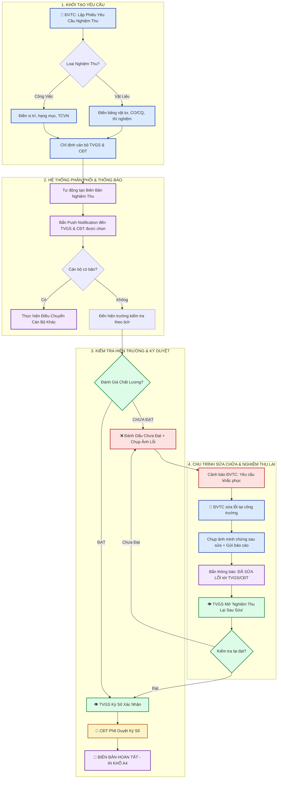
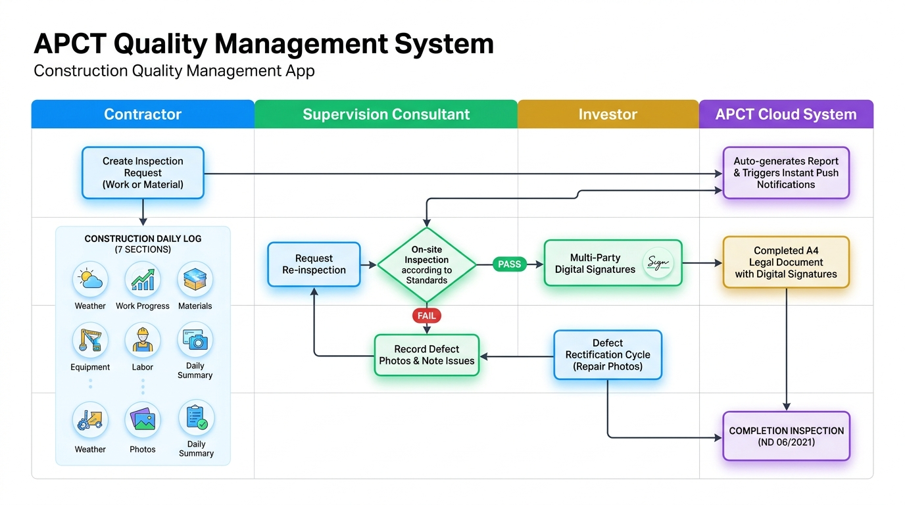

# HỆ THỐNG QUẢN LÝ CHẤT LƯỢNG & NGHIỆM THU XÂY DỰNG APCT
> **Tiêu chuẩn pháp lý:** Nghị định 06/2021/NĐ-CP của Chính phủ & Hệ thống Quy chuẩn / Tiêu chuẩn Xây dựng Việt Nam (TCVN, QCVN).  
> **Dự án áp dụng:** Khu đô thị An Phú Eco City - Cần Thơ (Chung cư Nhà ở Xã hội 2 - Khối Tòa A và Tòa B).

---

## MỤC LỤC
1. [Tổng Quan Ứng Dụng](#1-tổng-quan-ứng-dụng)
2. [Cơ Cấu Các Bên & Ma Trận Phân Quyền](#2-cơ-cấu-các-bên--ma-trận-phân-quyền)
3. [Quy Trình Nghiệp Vụ 1: Nghiệm Thu Công Việc & Vật Liệu](#3-quy-trình-nghiệp-vụ-1-nghiệm-thu-công-việc--vật-liệu)
4. [Quy Trình Nghiệp Vụ 2: Nhật Ký Thi Công Xây Dựng (7 Mục)](#4-quy-trình-nghiệp-vụ-2-nhật-ký-thi-công-xây-dựng-7-mục)
5. [Quy Trình Nghiệp Vụ 3: Biên Bản Nghiệm Thu Hoàn Thành](#5-quy-trình-nghiệp-vụ-3-biên-bản-nghiệm-thu-hoàn-thành)
6. [Hạ Tầng Dữ Liệu & Cơ Chế Đồng Bộ Thời Gian Thực](#6-hạ-tầng-dữ-liệu--cơ-chế-đồng-bộ-thời-gian-thực)
7. [Lưu Đồ Nghiệp Vụ Bằng Mermaid (Dùng xem trực tiếp trên GitHub/Notion)](#7-lưu-đồ-nghiệp-vụ-bằng-mermaid)
8. [Prompt Chuẩn Dùng Cho ChatGPT / AI Để Gen Ảnh Lưu Đồ Đồ Họa](#8-prompt-chuẩn-dùng-cho-chatgpt--ai-để-gen-ảnh-lưu-đồ)

---

## 1. TỔNG QUAN ỨNG DỤNG
Hệ thống **APCT Quality Management** là nền tảng số hóa toàn diện quy trình kiểm soát chất lượng công trình xây dựng tại hiện trường, thay thế 100% hồ sơ giấy rườm rà bằng quy trình ký số điện tử tức thì giữa 3 đến 4 chủ thể tham gia dự án.

Ứng dụng giải quyết 4 bài toán cốt lõi:
1. **Minh bạch và tức thời:** Đơn vị thi công tạo yêu cầu nghiệm thu trên điện thoại/máy tính -> Tư vấn giám sát & Chủ đầu tư nhận thông báo màn hình khóa (Web Push / OneSignal) ngay lập tức.
2. **Khép kín vòng đời xử lý lỗi (Rectification Loop):** Nếu công việc chưa đạt, ghi nhận hình ảnh khiếm khuyết hiện trường -> ĐVTC bắt buộc sửa chữa và nộp ảnh đối chứng -> TVGS nghiệm thu lại trước khi ký duyệt.
3. **Chuẩn hóa hồ sơ nghiệm thu theo pháp luật:** Định dạng in chuẩn khổ A4 xuất trình Thanh tra xây dựng và phục vụ nghiệm thu quyết toán công trình.
4. **Chống thất lạc dữ liệu:** Lưu trữ phân tầng đồng bộ 3 lớp: LocalStorage + IndexedDB (lưu trữ ảnh chất lượng cao không giới hạn) + Cloud Firestore Realtime.

---

## 2. CƠ CẤU CÁC BÊN & MA TRẬN PHÂN QUYỀN

| Chủ Thể | Đơn Vị Đại Diện | Chức Danh Cụ Thể | Quyền Hạn & Trách Nhiệm Chính |
| :--- | :--- | :--- | :--- |
| **ĐVTC** *(Đơn Vị Thi Công)* | **Công ty CP Xây dựng An Phú Gia** | • Chỉ huy trưởng công trường<br>• Kỹ sư kỹ thuật hiện trường | • Tạo Phiếu yêu cầu nghiệm thu (Công việc & Vật liệu).<br>• Tạo Nhật ký thi công hàng ngày (Mục 1 đến Mục 4).<br>• Tạo Biên bản nghiệm thu hoàn thành.<br>• Chụp ảnh sửa chữa khắc phục khi bị đánh giá Chưa Đạt. |
| **TVGS** *(Tư Vấn Giám Sát)* | **Công ty CP TVXD & TM GELICON** | • Tư vấn giám sát trưởng (`Đinh Xuân Thám`)<br>• Kỹ sư giám sát chuyên môn | • Nhận lời mời nghiệm thu, có quyền điều chuyển người khác nếu bận.<br>• Đánh giá Đạt hoặc Chưa Đạt tại hiện trường.<br>• Chụp ảnh lỗi khiếm khuyết khi từ chối.<br>• Ghi nhận xét, đánh giá an toàn vào Mục 5, 6, 7 của Nhật ký thi công.<br>• Ký số điện tử trên biên bản. |
| **CĐT** *(Chủ Đầu Tư)* | **Công ty TNHH An Phú Cần Thơ** | • Trưởng Ban QLDA (`Ngô Quý Linh`)<br>• Cán bộ Ban Quản lý dự án | • Giám sát tối cao quá trình nghiệm thu của TVGS.<br>• Phê duyệt xác nhận biên bản sau khi TVGS kiểm tra.<br>• Đồng xác nhận Nhật ký thi công và ký số nghiệm thu hoàn thành giai đoạn. |
| **TVTK** *(Tư Vấn Thiết Kế)* | **Công ty CP Tư vấn Thiết kế APCT** | • Chủ trì thiết kế kiến trúc/kết cấu | • Tham gia kiểm tra và ký số ở **Mẫu 1: Nghiệm thu hoàn thành hạng mục/công trình đưa vào sử dụng**. |
| **ADMIN** *(Quản Trị Viên)* | **Ban Quản Trị Hệ Thống APCT** | • Giám đốc công nghệ / Admin | • Quản lý danh sách 39+ cán bộ, mật khẩu, cơ cấu Trưởng - Cấp dưới.<br>• Giám sát toàn bộ phiếu, điều chuyển can thiệp khẩn cấp.<br>• Quản lý thư viện Tiêu chuẩn Việt Nam (TCVN, QCVN). |

### Quy Tắc Phân Quyền Xem Dữ Liệu & Nhận Thông Báo
- **Cán bộ thường (TVGS / CĐT viên):** Chỉ nhận thông báo và chỉ xem được các Phiếu yêu cầu / Biên bản mà mình được người tạo **chỉ định đích danh** tiếp nhận.
- **Cấp Trưởng (TVGS Trưởng / CĐT Trưởng):** Tự động xem được toàn bộ phiếu của tất cả cấp dưới mình quản lý và nhận thông báo các đầu việc quan trọng.
- **Nghiệm thu hoàn thành:** **Tự động gửi thẳng đến TVGS Trưởng và CĐT Trưởng**, không cần chọn người nhận thủ công.

---

## 3. QUY TRÌNH NGHIỆP VỤ 1: NGHIỆM THU CÔNG VIỆC & VẬT LIỆU

```
 [ĐVTC Tạo Phiếu Y/C (PYC)] 
             │
             ▼
 [Tự Động Sinh Biên Bản (BBNT) + Bắn Push Notification]
             │
             ├───> [TVGS hoặc CĐT Bận?] ──(Có)──> [Điều Chuyển Người Nhận Khác]
             │
             ▼
 [Kiểm Tra Hiện Trường Theo TCVN]
             │
             ├───[TRƯỜNG HỢP 1: ĐẠT] ──────────────────────────┐
             │   • TVGS ký số xác nhận                       │
             │   • CĐT ký số xác nhận                        │
             │   • Trạng thái: COMPLETED (Hoàn tất)          │
             │   • Xuất file in A4 lưu trữ pháp lý            │
             │                                               ▼
             └───[TRƯỜNG HỢP 2: CHƯA ĐẠT (REJECTED)] ────────┴─> [Lưu Hồ Sơ]
                 • Ghi rõ nội dung tồn tại, sai phạm
                 • Chụp & tải ảnh hiện trường khiếm khuyết
                 • Trạng thái chuyển: HAS_REJECTIONS (Chưa đạt)
                 │
                 ▼
          [ĐVTC Nhận Cảnh Báo Khẩn]
                 • Tiến hành sửa chữa tại công trường
                 • Chụp ảnh kết quả sau khi khắc phục xong
                 • Gửi phản hồi: Trạng thái chuyển RECTIFIED (Đã sửa)
                 │
                 ▼
          [TVGS & CĐT Nhận Thông Báo Đã Sửa]
                 • Mở chức năng: "Nghiệm Thu Lại Sau Sửa"
                 • So sánh ảnh trước & sau khắc phục
                 • Kiểm tra thực tế đạt yêu cầu -> Ký số hoàn tất!
```

### Điểm Khác Biệt Giữa Nghiệm Thu Công Việc & Vật Liệu:
- **Nghiệm thu công việc xây dựng:** Đính kèm Tiêu chuẩn áp dụng (TCVN 4453, TCVN 5637, QCVN 18...), vị trí trục, tầng cao, hạng mục thi công.
- **Nghiệm thu vật liệu đầu vào:** Bắt buộc nhập Bảng chi tiết vật tư (Tên thương mại, nhãn mác, quy cách, xuất xứ CO/CQ, số lượng lô hàng, biên bản lấy mẫu thí nghiệm hiện trường).

---

## 4. QUY TRÌNH NGHIỆP VỤ 2: NHẬT KÝ THI CÔNG XÂY DỰNG (7 MỤC)
Nhật ký thi công được lập hàng ngày theo mẫu chuẩn Nghị định 06/2021/NĐ-CP, phân chia trách nhiệm điền rõ ràng:

### Bước 1: Đơn Vị Thi Công Lập & Điền Mục 1 Đến Mục 4
1. **Mục 1 - Thời Tiết:** Chọn 3 khung giờ độc lập: Sáng (7h-11h), Chiều (13h-15h), Tối (18h-24h) + Trạng thái Nắng/Mưa kèm nhiệt độ.
2. **Mục 2 - Tình Hình Nhân Lực & Thiết Bị:**
   - Kỹ thuật: Tự động điền người lập.
   - Công nhân: Số lượng thực tế thi công.
   - Nhân lực khác: Chọn nhanh danh sách kỹ sư từ hệ thống.
   - Danh sách máy móc, thiết bị chính hoạt động tại hiện trường.
3. **Mục 3 - Tình Hình Thi Công Chi Tiết:** Mô tả khối lượng, công việc triển khai tại từng tòa nhà, tầng, trục.
4. **Mục 4 - Các Phát Sinh / Trở Ngại:** Ghi nhận sự cố, vướng mắc mặt bằng hoặc phát sinh kỹ thuật.

### Bước 2: Tư Vấn Giám Sát & Chủ Đầu Tư Tiếp Nhận & Ký Xác Nhận
5. **Mục 5 - Ý Kiến Nhận Xét Của TVGS:** Đánh giá tiến độ, chất lượng thi công trong ngày.
6. **Mục 6 - Đánh Giá An Toàn Lao Động & Vệ Sinh Môi Trường:** Kiểm tra trang bị BHLĐ, lưới an toàn, vệ sinh công nghiệp.
7. **Mục 7 - Kết Luận & Chấp Thuận:** TVGS điền kết luận -> Ký xác nhận -> CĐT đồng thời ký xác nhận -> Biên bản nhật ký hoàn tất 3 bên.

---

## 5. QUY TRÌNH NGHIỆP VỤ 3: BIÊN BẢN NGHIỆM THU HOÀN THÀNH
Được bố trí tại **Sidebar riêng biệt ("Nghiệm Thu Hoàn Thành")** với **Modal tạo mới chuyên dụng**, phục vụ các mốc nghiệm thu lớn của dự án:

### Cơ Chế Tự Động Phân Phối (Auto-Assignment):
Khác với nghiệm thu thường, biên bản hoàn thành do ĐVTC tạo sẽ **tự động phân phối trực tiếp đến:**
- **TVGS Trưởng:** `Đinh Xuân Thám` (Tư vấn giám sát trưởng)
- **CĐT Trưởng:** `Ngô Quý Linh` (Trưởng Ban Quản lý dự án)
*(Không cho phép chọn người nhận tùy tiện nhằm đảm bảo tính pháp lý cấp cao).*

### 3 Biểu Mẫu Pháp Lý Chuẩn Hóa:
1. **Mẫu 1 - Nghiệm Thu Hoàn Thành Hạng Mục / Công Trình Đưa Vào Sử Dụng (Ký 4 Bên):**
   - Áp dụng khi hoàn thành toàn bộ công trình hoặc tòa nhà.
   - Thành phần ký: **CĐT + TVTK + TVGS + ĐVTC**.
   - Kiểm tra kết quả PCCC, chạy thử liên động hệ thống cơ điện, môi trường.
2. **Mẫu 2 - Nghiệm Thu Hoàn Thành Giai Đoạn Thi Công Xây Dựng (Ký 3 Bên):**
   - Áp dụng khi xong phần móng hầm, phần thô kết cấu, phần hoàn thiện.
   - Thành phần ký: **CĐT + TVGS + ĐVTC**.
   - **Ghi nhận số đợt thanh toán (ví dụ: Đợt 02)** làm cơ sở pháp lý để Chủ đầu tư giải ngân tiền cho Nhà thầu.
3. **Mẫu 3 - Kiểm Tra Hồ Sơ Nghiệm Thu Chất Lượng Hoàn Thành Giai Đoạn (Ký 3 Bên):**
   - Kiểm tra danh mục **12 đầu mục hồ sơ quản lý chất lượng** (Chứng chỉ xuất xưởng, kết quả nén mẫu bê tông, bản vẽ hoàn công, nhật ký công trình...).

---

## 6. HẠ TẦNG DỮ LIỆU & CƠ CHẾ ĐỒNG BỘ THỜI GIAN THỰC

```
                      ┌───────────────────────────────────────────────┐
                      │             GOOGLE CLOUD FIRESTORE            │
                      │  (Single Source of Truth - Realtime Database) │
                      └───────┬───────────────────────────────▲───────┘
                              │                               │
                      Snapshot Listener                Offline Mutation
                              │                               │
                              ▼                               │
                      ┌───────────────────────────────────────┴───────┐
                      │           CLIENT STATE MANAGER (REACT)        │
                      └───────┬───────────────────────────────▲───────┘
                              │                               │
                   Write Local Cache                   Recover Cache
                              │                               │
             ┌────────────────┴───────────────┐               │
             ▼                                ▼               │
┌─────────────────────────┐      ┌────────────────────────────┴───────┐
│      LOCALSTORAGE       │      │             INDEXEDDB              │
│ (Metadata, Auth, Notif) │      │ (Chứa ảnh gốc, ảnh lỗi & khắc phục) │
└─────────────────────────┘      └────────────────────────────────────┘
```

- **OneSignal Web Push SDK:** Bắn thông báo nổi trên desktop và điện thoại ngay cả khi người dùng không mở trình duyệt hoặc khóa màn hình.
- **IndexedDB Dual-Layer Storage:** Ảnh hiện trường và ảnh khắc phục có dung lượng lớn được lưu trữ an toàn trong IndexedDB của trình duyệt, ngăn chặn 100% lỗi tràn dung lượng `QuotaExceededError` của LocalStorage.

---

## 7. LƯU ĐỒ NGHIỆP VỤ BẰNG MERMAID
*(Bạn có thể dán đoạn mã này vào [Mermaid Live Editor](https://mermaid.live/) hoặc các trang hỗ trợ Markdown để xem biểu đồ tương tác).*



### Ảnh Lưu Đồ Quy Trình Thực Tế (Workflow Graphic):


---

## 8. PROMPT CHUẨN DÙNG CHO CHATGPT / AI ĐỂ GEN ẢNH LƯU ĐỒ

Khi cần đưa cho các công cụ AI (ChatGPT 4o, DALL-E 3, Midjourney, Whimsical AI, Napkin AI) để tạo ra **1 bức ảnh infographic / lưu đồ đồ họa chuyên nghiệp**, hãy sao chép đoạn prompt dưới đây:

```text
Bạn là một chuyên gia thiết kế đồ họa quy trình (Business Process Infographic Designer). Hãy vẽ một sơ đồ lưu đồ (Flowchart Infographic) cực kỳ chuyên nghiệp, hiện đại, sắc nét về "QUY TRÌNH QUẢN LÝ CHẤT LƯỢNG VÀ NGHIỆM THU CÔNG TRÌNH XÂY DỰNG APCT THEO NGHỊ ĐỊNH 06/2021/NĐ-CP".

YÊU CẦU PHONG CÁCH THIẾT KẾ:
- Phong cách: Corporate SaaS / Enterprise Tech Clean Style, hiện đại, màu sắc trực quan, nền sáng (Light background) hoặc công nghệ (Tech blue).
- Chia 4 cột bơi (Swimlanes) đại diện cho 4 chủ thể tham gia:
  1. Cột 1 (Xanh dương - Blue): ĐƠN VỊ THI CÔNG (ĐVTC - Nhà thầu An Phú Gia)
  2. Cột 2 (Xanh lá cây - Green): TƯ VẤN GIÁM SÁT (TVGS - Công ty GELICON)
  3. Cột 3 (Vàng cam - Amber/Gold): ĐẠI DIỆN CHỦ ĐẦU TƯ (CĐT - An Phú Cần Thơ)
  4. Cột 4 (Tím - Purple): HỆ THỐNG APCT APP (Tự động hóa Cloud & Push Notification)

NỘI DUNG CÁC BƯỚC CẦN THỂ HIỆN TRÊN LƯU ĐỒ:
Bước 1: [ĐVTC] Lập Phiếu yêu cầu nghiệm thu (Công việc xây dựng hoặc Vật tư đầu vào kèm bảng kê CO/CQ).
Bước 2: [Hệ Thống] Tự động sinh Biên bản nghiệm thu điện tử tương ứng và bắn Web Push Notification tới TVGS và CĐT được chỉ định. Có nhánh phụ: "Điều chuyển cán bộ tiếp nhận nếu bận".
Bước 3: [TVGS & CĐT] Cùng ĐVTC kiểm tra hiện trường theo Tiêu chuẩn TCVN.
Bước 4: [Điểm Rẽ Nhánh Quyết Định]:
  - NHÁNH A (ĐẠT): TVGS ký số điện tử -> CĐT ký số điện tử -> Biên bản đạt trạng thái HOÀN TẤT (COMPLETED) -> Xuất bản in A4 pháp lý.
  - NHÁNH B (CHƯA ĐẠT - REJECTED): TVGS ghi chú nội dung sai sót và chụp ảnh hiện trường khiếm khuyết. Hệ thống chuyển trạng thái "CẦN SỬA CHỮA".
Bước 5 [Vòng lặp sửa chữa]: ĐVTC sửa chữa tại hiện trường -> Chụp ảnh sau khắc phục -> Gửi minh chứng. Hệ thống báo TVGS -> TVGS vào "Nghiệm Thu Lại" -> So sánh ảnh trước & sau -> Đạt yêu cầu thì ký duyệt hoàn tất.

KHỐI BỔ TRỢ (ĐẶT Ở GÓC DƯỚI):
- Khối 1: NHẬT KÝ THI CÔNG HÀNG NGÀY (7 Mục: ĐVTC điền Mục 1-4 về thời tiết 3 khung giờ, nhân lực, thiết bị; TVGS & CĐT điền và ký Mục 5, 6, 7 về nhận xét và an toàn).
- Khối 2: NGHIỆM THU HOÀN THÀNH (Tự động gửi trực tiếp cấp Trưởng: TVGS Trưởng & CĐT Trưởng với 3 Mẫu: Hoàn thành công trình 4 bên, Hoàn thành giai đoạn 3 bên làm căn cứ thanh toán, và Kiểm tra 12 đầu mục hồ sơ chất lượng).

Hình ảnh cần hiển thị rõ các mũi tên định hướng, icon trực quan (Mũ bảo hộ công trình, Kính hiển vi giám sát, Tòa nhà chủ đầu tư, Chuông thông báo, Chữ ký số, Dấu tích xanh Đạt, Dấu chéo đỏ Chưa Đạt). Văn bản tiếng Việt rõ ràng, dễ đọc.
```
