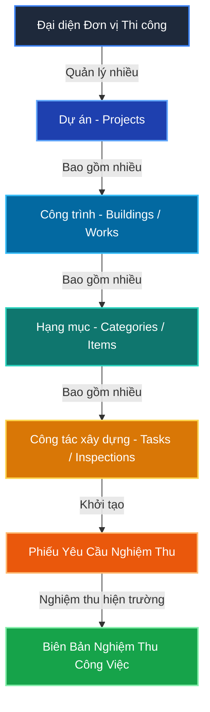
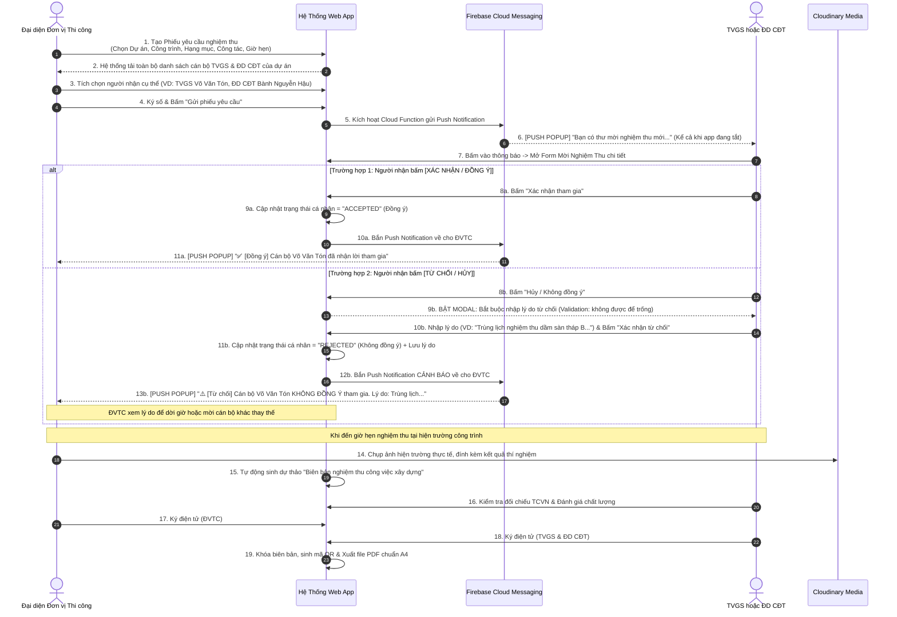
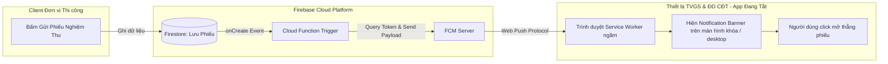

# TÀI LIỆU ĐẶC TẢ YÊU CẦU & THIẾT KẾ HỆ THỐNG
## ỨNG DỤNG QUẢN LÝ NGHIỆM THU CÔNG TRÌNH XÂY DỰNG (APCT)

---

> **Dự án mẫu tham chiếu:** Dự án Đầu tư Xây dựng Nhà Ở Phường Thường Thạnh - An Phú Eco City  
> **Công trình:** Chung cư nhà ở xã hội 2  
> **Hạng mục:** Thi công phần kết cấu – Tòa A và Tòa B  
> **Công nghệ cốt lõi:** Google Firebase (Auth, FCM, Functions), Google Cloud Firestore, Cloudinary Media  
> **Nền tảng:** Web App Responsive (hỗ trợ Progressive Web App - PWA chạy tốt trên PC, Tablet, Android, iOS)

---

## 1. TỔNG QUAN HỆ THỐNG & MỤC TIÊU DỰ ÁN

### 1.1. Bối cảnh & Vấn đề thực tế
Trong công tác thi công và quản lý chất lượng xây dựng (theo Nghị định 06/2021/NĐ-CP):
- Quy trình lập hồ sơ giấy tờ, gửi **Phiếu yêu cầu nghiệm thu** từ Nhà thầu thi công đến Tư vấn giám sát (TVGS) và Đại diện Chủ đầu tư (ĐD CĐT) thường bị trễ, thất lạc hoặc không kịp thời.
- Việc tập hợp các bên ra hiện trường tốn nhiều thời gian gọi điện thoại, nhắn tin riêng lẻ.
- Biên bản nghiệm thu công việc xây dựng trên hiện trường cần đối chiếu nhiều tiêu chuẩn (TCVN), bản vẽ BVTC, kết quả thí nghiệm; khi ký giấy thủ công rất dễ sai sót hoặc chậm trễ hoàn công.

### 1.2. Mục tiêu của Web App
1. **Số hóa 100% quy trình nghiệm thu công việc xây dựng:** Từ khâu gửi phiếu yêu cầu, thông báo tức thì, kiểm tra hiện trường, lập biên bản, ký duyệt và xuất file PDF.
2. **Phân quyền chặt chẽ theo 4 vai trò (Roles):** Gồm **Admin** (Quản trị hệ thống, cấp tài khoản, phân bổ dự án), **Đại diện đơn vị thi công** (Role *duy nhất* có quyền lập phiếu yêu cầu nghiệm thu), **Tư vấn giám sát** (Kiểm tra, đánh giá kỹ thuật) và **Đại diện chủ đầu tư** (Giám sát, phê duyệt).
3. **Cơ chế thông báo thời gian thực (Push Notification):** Người được chỉ định (TVGS, ĐD CĐT) sẽ nhận được thông báo ngay trên màn hình thiết bị (kể cả khi tắt trình duyệt / không mở app).
4. **Quản lý đa cấp trực quan:** Hỗ trợ mô hình 1 Đơn vị thi công phụ trách nhiều Dự án -> Công trình -> Hạng mục -> Công tác xây dựng.
5. **Lưu trữ bằng chứng số hóa:** Hình ảnh nghiệm thu thực tế, bản vẽ BVTC, kết quả kiểm tra được tải lên Cloudinary có đóng dấu thời gian (timestamp).

---

## 2. KIẾN TRÚC PHÂN CẤP DỮ LIỆU (DATA HIERARCHY)

Hệ thống được tổ chức theo cây phân cấp dữ liệu 4 tầng chặt chẽ:



### Chi tiết các cấp dữ liệu:
1. **Cấp 1 - Dự án (Project):**
   - Ví dụ thực tế: *Đầu tư Xây Dựng Nhà Ở Phường Thường Thạnh - An Phú Eco City*
   - Thông tin: Tên dự án, Địa điểm xây dựng, Chủ đầu tư (Cty TNHH An Phú Cần Thơ), Nhà thầu chính (Cty CP Xây dựng An Phú Gia), Đơn vị TVGS (Cty CP TVXD & TM GELICON), Thời gian khởi công - hoàn thành.
2. **Cấp 2 - Công trình (Building / Sub-project):**
   - Ví dụ thực tế: *Chung cư nhà ở xã hội 2*
   - Thuộc Dự án tương ứng, phân biệt các khối tháp/nhà liền kề.
3. **Cấp 3 - Hạng mục (Category / Section):**
   - Ví dụ thực tế: *Thi công phần kết cấu – Tòa A và Tòa B*, *Thi công phần ngầm*, *Thi công hoàn thiện*.
4. **Cấp 4 - Công tác xây dựng yêu cầu nghiệm thu (Inspection Task):**
   - Ví dụ thực tế: *Nghiệm thu công tác định vị tim trục dầm sàn tầng 2 trục 1-13/A-D Tòa A*.
   - Đây là đối tượng trực tiếp được gắn với Phiếu yêu cầu nghiệm thu và Biên bản nghiệm thu.

---

## 3. MÔ HÌNH PHÂN QUYỀN VAI TRÒ (ROLES & RBAC PERMISSIONS)

Hệ thống thiết lập **4 vai trò (Roles)** với trách nhiệm và thẩm quyền phân cấp minh bạch:

| Vai trò (Role) | Ký hiệu | Đại diện pháp nhân / Đối tượng | Quyền hạn & Trách nhiệm chính trong hệ thống |
| :--- | :--- | :--- | :--- |
| **Quản trị viên Hệ thống** | `ADMIN` | Ban quản trị kỹ thuật / Giám đốc điều hành công nghệ | - **Toàn quyền quản trị hệ thống:** Khởi tạo, cấp mới, khóa tài khoản người dùng.<br>- **Phân quyền vai trò:** Gán người dùng vào 1 trong các role (`ADMIN`, `CONTRACTOR`, `SUPERVISOR`, `INVESTOR`).<br>- **Quản lý phân bổ dự án:** Gán Đơn vị thi công, TVGS, ĐD CĐT phụ trách các dự án cụ thể.<br>- **Quản lý cấu hình danh mục dùng chung:** Thư viện Tiêu chuẩn xây dựng (TCVN, QCVN), biểu mẫu biên bản, mẫu chữ ký.<br>- **Giám sát & Nhật ký (Audit Log):** Xem toàn bộ lịch sử tạo phiếu, gửi thông báo FCM, tải tệp, phát hiện lỗi.<br>- **Cấu hình tích hợp:** Quản lý khóa API Firebase, Cloudinary, Web Push VAPID keys. |
| **Đại diện Đơn vị Thi công** | `CONTRACTOR` | *Cty CP Xây dựng An Phú Gia* (Chỉ huy trưởng, Kỹ thuật hiện trường) | - **ĐẶC QUYỀN DUY NHẤT:** Là vai trò **duy nhất** có quyền lập & phát hành **Phiếu yêu cầu nghiệm thu** (Không role nào khác được tạo phiếu).<br>- Tạo và cập nhật Cây dữ liệu công trình được phân công: Dự án -> Công trình -> Hạng mục -> Công tác nghiệm thu.<br>- Chọn đích danh cán bộ TVGS và ĐD CĐT tiếp nhận phiếu mời nghiệm thu.<br>- Chụp & tải ảnh nghiệm thu hiện trường lên Cloudinary (tự động đóng dấu GPS & thời gian).<br>- Ký số / ký điện tử vào Phiếu yêu cầu & Biên bản nghiệm thu. |
| **Tư vấn Giám sát** | `SUPERVISOR` | *Cty CP TVXD & TM GELICON* (TVGS trưởng, Cán bộ TVGS) | - Nhận Push Notification tức thì khi có phiếu nghiệm thu gửi đến (kể cả khi không mở app).<br>- Xem lịch hẹn, xác nhận tham gia hoặc phản hồi yêu cầu dời lịch nghiệm thu.<br>- Đánh giá các tiêu chuẩn kỹ thuật (TCVN, BVTC, hồ sơ vật liệu đầu vào, nhật ký thi công).<br>- Ghi ý kiến độc lập, đánh giá chất lượng (Đạt / Không đạt / Yêu cầu sửa chữa).<br>- Ký số / ký điện tử vào Biên bản nghiệm thu công việc xây dựng. |
| **Đại diện Chủ đầu tư** | `INVESTOR` | *Cty TNHH An Phú Cần Thơ* (Trưởng Ban QLDA, Cán bộ Ban QLDA) | - Nhận Push Notification tức thì khi có phiếu nghiệm thu gửi đến (kể cả khi không mở app).<br>- Giám sát tiến độ nghiệm thu xuyên suốt các công trình thuộc dự án đầu tư.<br>- Trực tiếp tham gia kiểm tra hiện trường cùng TVGS và ĐVTC.<br>- Đưa ra ý kiến phê duyệt cuối cùng (Đồng ý / Không đồng ý cho triển khai công việc tiếp theo).<br>- Ký số Biên bản nghiệm thu; phê duyệt và xuất báo cáo PDF lưu trữ. |

> [!IMPORTANT]
> **Quy tắc cốt lõi về thẩm quyền tạo phiếu:**  
> Hệ thống áp dụng quy tắc kiểm tra nghiêm ngặt ở cả tầng Giao diện (UI) và tầng Dữ liệu (Firestore Rules & Cloud Functions): **Chỉ tài khoản có `role == 'CONTRACTOR'` mới nhìn thấy nút "Tạo phiếu yêu cầu" và được phép ghi dữ liệu tạo mới vào collection `inspection_requests`.** Cả `SUPERVISOR` lẫn `INVESTOR` đều không có quyền khởi tạo phiếu này nhằm đảm bảo tính toàn vẹn pháp lý trong xây dựng. `ADMIN` đóng vai trò quản trị hạ tầng và dữ liệu danh mục.

---

## 4. QUY TRÌNH NGHIỆP VỤ CHUẨN (END-TO-END WORKFLOW)



---

## 5. THIẾT KẾ CÁC BIỂU MẪU CHUẨN (DỰA TRÊN ẢNH MẪU THỰC TẾ)

### 5.1. BIỂU MẪU 1: PHIẾU YÊU CẦU NGHIỆM THU

*Ánh xạ chính xác theo mẫu văn bản trong hình ảnh đính kèm:*

```text
                                                 Cần Thơ, ngày ... tháng ... năm 20...
                   PHIẾU YÊU CẦU NGHIỆM THU
                             Số: PYC-2026/03-01
                             
Dự án:                 Đầu tư Xây Dựng Nhà Ở Phường Thường Thạnh - An Phú Eco City
Công trình:            Chung cư nhà ở xã hội 2
Hạng mục:              Thi công phần kết cấu - Tòa A và Tòa B
Địa điểm xây dựng:     Đường Trương Vĩnh Nguyên – Phường Cái Răng – Thành phố Cần Thơ
Đơn vị yêu cầu NT:     Công ty CP Xây dựng An Phú Gia
Công tác XD yêu cầu NT:
    - Nghiệm thu công tác định vị tim trục dầm sàn tầng 2 trục 1-13/A-D Tòa A

Nội dung yêu cầu:
Sau khi kiểm tra chất lượng, đối chiếu với bản vẽ thiết kế và các tiêu chuẩn kỹ thuật
được áp dụng, chúng tôi đã nghiệm thu nội bộ. Vậy nhà thầu thi công đề nghị Chủ đầu tư
và Tư vấn giám sát nghiệm thu.

Thời gian nghiệm thu:  15h30, ngày ... tháng ... năm 20...
Tại:                   Đầu tư Xây dựng Nhà ở Phường Thường Thạnh - An Phú Eco City

                                                        Đại diện đơn vị thi công
                                                          (Ký, ghi rõ họ tên)
--------------------------------------------------------------------------------
Nơi nhận: (Thời gian nhận: 10h30, ngày ... tháng ... năm 20...)
- TVGS:    [Chọn từ danh bạ: Võ Văn Tón]        - Trạng thái nhận: [Đã nhận / Ký nhận]
- Đ.D CĐT: [Chọn từ danh bạ: Bành Nguyễn Hậu]   - Trạng thái nhận: [Đã nhận / Ký nhận]
- Lưu:     Hồ sơ chất lượng công trình
```

#### Các trường dữ liệu (Form Fields) cần nhập trên Web App:
- **Mã số phiếu:** Tự động sinh theo cấu trúc `PYC-[Năm][Tháng]-[Số thứ tự]` (hoặc cho phép nhập thủ công).
- **Ngày lập & Địa phương:** Mặc định lấy ngày hiện tại (vd: Cần Thơ, ngày... tháng... năm...).
- **Chọn Dự án:** Dropdown list (dữ liệu từ cấp 1).
- **Chọn Công trình:** Dropdown filter phụ thuộc vào Dự án (cấp 2).
- **Chọn Hạng mục:** Dropdown filter phụ thuộc vào Công trình (cấp 3).
- **Chọn / Nhập Công tác xây dựng:** Nhập chi tiết nội dung (ví dụ: *Nghiệm thu công tác định vị tim trục dầm sàn tầng 2 trục 1-13/A-D Tòa A*).
- **Thời gian nghiệm thu dự kiến:** Ngày, giờ cụ thể (vd: 15:30 16/12/2026).
- **Địa điểm nghiệm thu:** Tự động điền theo Dự án, cho phép chỉnh sửa chi tiết (vị trí tầng, trục).
- **Cơ chế chọn người nhận (Recipient Selection):**
  - **Nhóm 1 - Cán bộ Tư vấn Giám sát (TVGS):** Hệ thống lọc và liệt kê toàn bộ nhân sự thuộc vai trò `SUPERVISOR` đã được gán vào dự án này. ĐVTC có thể tích chọn 1 hoặc nhiều người (hiển thị: Họ tên, Chức vụ, Avatar, Số điện thoại).
  - **Nhóm 2 - Đại diện Chủ đầu tư (ĐD CĐT / Ban QLDA):** Hệ thống lọc và liệt kê toàn bộ nhân sự thuộc vai trò `INVESTOR` đã được gán vào dự án. ĐVTC tích chọn 1 hoặc nhiều người nhận thông báo.
- **Thời gian gửi phiếu:** Tự động ghi nhận timestamp chính xác khi nhấn nút "Gửi".

---

### 5.2. BIỂU MẪU 2: BIÊN BẢN NGHIỆM THU CÔNG VIỆC XÂY DỰNG

*Ánh xạ chính xác theo mẫu biên bản 2 trang trong hình ảnh đính kèm:*

```text
                                                 Cần Thơ, ngày ... tháng ... năm 20...
             BIÊN BẢN NGHIỆM THU CÔNG VIỆC XÂY DỰNG
                             Số: BBNT-2026/03-01
                             Số tài liệu căn cứ: TLCC-...

Dự án:                 Đầu tư xây dựng nhà ở Phường Thường Thạnh - An Phú Eco City
Công trình:            Chung cư nhà ở xã hội 2
Hạng mục:              Thi công phần kết cấu – tòa A và toà B
Địa điểm xây dựng:     Phường Cái Răng – Thành phố Cần Thơ

1. Đối tượng nghiệm thu:
   - Nghiệm thu công tác định vị tim trục dầm sàn tầng 2 trục 1-13/A-D Tòa A

2. Thành phần trực tiếp nghiệm thu:
   a) Đại diện Chủ đầu tư: Công ty TNHH An Phú Cần Thơ
      - Ông: Ngô Quý Linh        Chức vụ: Trưởng Ban QLDA
      - Ông: Bành Nguyễn Hậu     Chức vụ: Cán bộ ban QLDA
      - Ông: [Tùy chọn thêm]     Chức vụ: Cán bộ ban QLDA
   b) Tư vấn giám sát: Công ty CP Tư vấn Xây dựng và Thương mại GELICON.
      - Ông: Đinh Xuân Thám      Chức vụ: Tư vấn giám sát trưởng
      - Ông: Võ Văn Tón          Chức vụ: Cán bộ tư vấn giám sát
      - Ông: [Tùy chọn thêm]     Chức vụ: Cán bộ tư vấn giám sát
   c) Đơn vị thi công: Công ty CP Xây dựng An Phú Gia.
      - Ông: [Chỉ định]          Chức vụ: Chỉ huy trưởng
      - Ông: [Chỉ định]          Chức vụ: Kỹ thuật hiện trường

3. Thời gian nghiệm thu:
   - Bắt đầu: 15h30, ngày ... tháng ... năm 20...
   - Kết thúc: 16h30, ngày ... tháng ... năm 20...
   - Tại: Dự án Đầu tư xây dựng nhà ở Phường Thường Thạnh - An Phú Eco City

4. Đánh giá công việc xây dựng đã thực hiện:
   4.1. Tài liệu căn cứ nghiệm thu:
      4.1.1 Phiếu yêu cầu nghiệm thu của nhà thầu thi công số: [Liên kết tự động PYC]
      4.1.2 Hồ sơ thiết kế BVTC (đã được chủ đầu tư phê duyệt ngày 16 tháng 12 năm 2025).
            + Tên hồ sơ thiết kế: Hồ sơ thiết kế xây dựng triển khai sau hồ sơ TKCS.
            + Những thay đổi thiết kế đã được chấp thuận: [Không / hoặc nhập số hiệu RFA, RFI, bản vẽ]
      4.1.3 Biện pháp thi công đã được phê duyệt: [Tên biện pháp thi công]
      4.1.4 Quy chuẩn, tiêu chuẩn xây dựng được áp dụng (Checkbox tích chọn / thêm mới):
            [X] TCVN 5637:1991 Quản lý chất lượng xây lắp công trình xây dựng – Nguyên tắc cơ bản.
            [X] TCVN 9398:2012 Công tác trắc địa trong xây dựng công trình – Yêu cầu chung.
            [X] TCVN 4055:2012 Công trình xây dựng - Tổ chức thi công.
            [X] QCVN 18:2021/BXD về An toàn trong thi công xây dựng.
            [X] TCVN 5308:1991 Quy phạm kỹ thuật an toàn trong xây dựng.
            [X] TCVN 4453:1995 Kết cấu bê tông và bê tông cốt thép - Thi công và nghiệm thu.
      4.1.5 Biên bản nghiệm thu vật liệu đầu vào: [Số hiệu BBNT vật liệu hoặc liên kết đính kèm]
      4.1.6 Các kết quả kiểm tra, thí nghiệm chất lượng vật liệu, thiết bị: [Số phiếu thí nghiệm]
      4.1.7 Nhật ký thi công: [Số trang / ngày ghi nhật ký]
   4.2. Chất lượng công việc xây dựng:
      - Đối chiếu với hồ sơ thiết kế được duyệt: [X] Đạt yêu cầu   [ ] Không đạt
      - Đánh giá sự phù hợp của công việc so với TCXD: [X] Đạt yêu cầu   [ ] Không đạt
      - Kiểm tra việc thực hiện theo yêu cầu kỹ thuật: [X] Đạt yêu cầu   [ ] Không đạt
   4.3. Các ý kiến khác nếu có: [Nhập ý kiến hoặc mặc định ghi "Không"]

5. Kết luận:
   - [X] Chấp nhận nghiệm thu, đồng ý cho triển khai công việc tiếp theo: [X] Đồng ý   [ ] Không đồng ý
   - [ ] Không chấp nhận nghiệm thu: [ ] Không đồng ý
   - Yêu cầu sửa chữa, hoàn thiện công việc xây dựng đã thực hiện: [Mặc định: "Không có"]
   - Các yêu cầu khác (nếu có): [Mặc định: "Không có"]

--------------------------------------------------------------------------------
                   CHỮ KÝ ĐIỆN TỬ CỦA CÁC THÀNH PHẦN NGHIỆM THU
   CHỦ ĐẦU TƯ / BAN QLDA         TƯ VẤN GIÁM SÁT           ĐƠN VỊ THI CÔNG
       (Ký, ghi rõ họ tên)     (Ký, ghi rõ họ tên)       (Ký, ghi rõ họ tên)
```

---

## 6. THIẾT KẾ KIẾN TRÚC KỸ THUẬT (TECHNICAL ARCHITECTURE)

### 6.1. Tech Stack Được Đề Xuất
1. **Frontend:**
   - **Framework:** React / Vite hoặc Next.js (chạy SPA + PWA) hỗ trợ cài đặt trên điện thoại như ứng dụng native (Add to Home Screen).
   - **UI Design:** Vanilla CSS / Modern Clean Architecture với CSS Variables, hỗ trợ Dark Mode & Light Mode, giao diện responsive mượt mà từ Mobile đến Desktop màn hình lớn.
   - **Chữ ký điện tử:** HTML5 Canvas Signature Pad (cho phép ký tay trực tiếp bằng ngón tay hoặc bút cảm ứng trên điện thoại).
   - **PDF Generator:** `pdfmake` hoặc `@react-pdf/renderer` hoặc Cloud Function Puppeteer để in xuất mẫu A4 chuẩn thể thức Bộ Xây Dựng.

2. **Backend & Cloud Services:**
   - **Google Firebase Authentication:** Xác thực tài khoản qua Email/Mật khẩu hoặc Số điện thoại; tích hợp Role-based Custom Claims.
   - **Google Cloud Firestore Database:** Cơ sở dữ liệu NoSQL thời gian thực, lưu trữ hồ sơ công trình, phiếu nghiệm thu, trạng thái biên bản.
   - **Firebase Cloud Messaging (FCM) & Web Push API:** Quản lý Service Worker gửi thông báo nền (Background Notification) tới thiết bị cả khi đóng trình duyệt.
   - **Firebase Cloud Functions (Node.js):** Trigger tự động khi có document mới trong collection `inspection_requests` để dispatch push notification đến danh sách token của TVGS & ĐD CĐT.
   - **Cloudinary:** Dịch vụ lưu trữ Media chuyên dụng. Upload ảnh nghiệm thu hiện trường, nén ảnh tự động chuẩn WebP, gắn watermark GPS tọa độ và thời gian thực để đảm bảo tính pháp lý.

---

## 7. CƠ CHẾ THÔNG BÁO NỀN (BACKGROUND PUSH NOTIFICATION)

Yêu cầu quan trọng của người dùng: **"khi ấn gửi hay gì đó thì bên người kia có thông báo dù không mở app"**.

### 7.1. Nguyên lý hoạt động Web Push với Firebase Cloud Messaging (FCM)
Để nhận được thông báo khi người dùng **đã đóng hoàn toàn ứng dụng / tắt tab trình duyệt**:
1. Ứng dụng phải đăng ký một **Service Worker** chạy ngầm ở cấp hệ điều hành trình duyệt (`firebase-messaging-sw.js`).
2. Trình duyệt client xin quyền `Notification.requestPermission()`.
3. Khi được cấp quyền, FCM SDK sinh ra một chuỗi `fcm_device_token` duy nhất đại diện cho thiết bị đó.
4. Token này được lưu trữ trong Firestore tại collection `users/{userId}/fcm_tokens/{tokenId}`.
5. Khi Đơn vị thi công bấm **"Gửi phiếu yêu cầu"**:
   - Backend Cloud Function lấy danh sách `fcm_tokens` của các TVGS và ĐD CĐT được chọn trong phiếu.
   - Gửi payload notification qua chuẩn **FCM HTTP v1 API**.
   - Service Worker của trình duyệt (trên Android, Windows, macOS, iOS 16.4+) tiếp nhận gói tin và kích hoạt thông báo hệ thống (System Tray Notification / Banner).
   - Người dùng bấm vào thông báo -> Trình duyệt tự mở app và điều hướng thẳng vào trang chi tiết phiếu nghiệm thu cần xử lý.



### 7.2. Các mẫu Payload Notification 2 chiều

#### 7.2.1. Payload gửi Thư mời nghiệm thu (ĐVTC ➔ TVGS & ĐD CĐT)
```json
{
  "notification": {
    "title": "📋 Thư mời nghiệm thu mới: Định vị tim trục dầm sàn Tòa A",
    "body": "ĐVTC An Phú Gia mời bạn tham gia nghiệm thu lúc 15h30 hôm nay tại Chung cư NOXH 2.",
    "icon": "/icons/icon-192x192.png",
    "badge": "/icons/badge-72x72.png"
  },
  "data": {
    "type": "NEW_INVITATION",
    "requestId": "req_20261005_001",
    "projectId": "proj_anphu_01",
    "click_action": "https://app-apct.web.app/invitations/req_20261005_001"
  }
}
```

#### 7.2.2. Payload phản hồi ĐỒNG Ý tham gia (TVGS/CĐT ➔ ĐVTC)
```json
{
  "notification": {
    "title": "✅ Xác nhận tham gia nghiệm thu",
    "body": "Cán bộ Võ Văn Tón (TVGS) đã ĐỒNG Ý tham gia nghiệm thu công tác: Định vị tim trục dầm sàn.",
    "icon": "/icons/icon-192x192.png"
  },
  "data": {
    "type": "INVITATION_ACCEPTED",
    "requestId": "req_20261005_001",
    "responderName": "Võ Văn Tón",
    "click_action": "https://app-apct.web.app/inspections/req_20261005_001"
  }
}
```

#### 7.2.3. Payload phản hồi TỪ CHỐI / HỦY KÈM LÝ DO (TVGS/CĐT ➔ ĐVTC)
```json
{
  "notification": {
    "title": "⚠️ TỪ CHỐI tham gia nghiệm thu",
    "body": "Cán bộ Võ Văn Tón (TVGS) KHÔNG ĐỒNG Ý. Lý do: 'Trùng lịch nghiệm thu cốt thép dầm sàn Tòa B'",
    "icon": "/icons/icon-warning-192x192.png"
  },
  "data": {
    "type": "INVITATION_REJECTED",
    "requestId": "req_20261005_001",
    "responderName": "Võ Văn Tón",
    "rejectionReason": "Trùng lịch nghiệm thu cốt thép dầm sàn Tòa B",
    "click_action": "https://app-apct.web.app/inspections/req_20261005_001"
  }
}
```

---

## 8. THIẾT KẾ CƠ SỞ DỮ LIỆU FIRESTORE (DATABASE SCHEMA)

### 8.1. Collection: `users` (Danh sách người dùng và cán bộ)
```json
// Document ID: userId (từ Firebase Auth)
{
  "uid": "user_xyz001",
  "fullName": "Võ Văn Tón",
  "email": "vovanton.gelicon@gmail.com",
  "phone": "0912345678",
  "role": "SUPERVISOR", // "ADMIN" | "CONTRACTOR" | "SUPERVISOR" | "INVESTOR"
  "company": "Công ty CP Tư vấn Xây dựng và Thương mại GELICON",
  "position": "Cán bộ tư vấn giám sát", // "Quản trị viên" | "Trưởng Ban QLDA" | "TVGS trưởng" | "Chỉ huy trưởng" | "Kỹ thuật hiện trường"...
  "avatarUrl": "https://res.cloudinary.com/.../avatar.jpg",
  "assignedProjects": ["proj_anphu_01"],
  "createdAt": "2026-10-05T15:00:00Z"
}
```

### 8.2. Subcollection: `users/{userId}/fcm_tokens` (Thiết bị nhận thông báo)
```json
// Document ID: tokenId
{
  "token": "eX_9Kq...fcm_token_string...",
  "deviceInfo": "Chrome Windows 11 / Safari iOS 17.5",
  "lastUpdated": "2026-10-05T15:00:00Z"
}
```

### 8.3. Collection: `projects` (Cấp 1 - Dự án)
```json
// Document ID: proj_anphu_01
{
  "id": "proj_anphu_01",
  "projectName": "Đầu tư Xây Dựng Nhà Ở Phường Thường Thạnh - An Phú Eco City",
  "location": "Đường Trương Vĩnh Nguyên – Phường Cái Răng – Thành phố Cần Thơ",
  "investorName": "Công ty TNHH An Phú Cần Thơ",
  "contractorName": "Công ty CP Xây dựng An Phú Gia",
  "supervisorName": "Công ty CP Tư vấn Xây dựng và Thương mại GELICON",
  "members": {
    "contractorUids": ["uid_dvtc_01", "uid_dvtc_02"],
    "supervisorUids": ["uid_tvgs_01", "uid_tvgs_02"],
    "investorUids": ["uid_cdt_01", "uid_cdt_02"]
  },
  "createdAt": "2026-10-01T08:00:00Z"
}
```

### 8.4. Subcollection: `projects/{projId}/buildings` (Cấp 2 - Công trình)
```json
// Document ID: bld_chungcu_02
{
  "id": "bld_chungcu_02",
  "buildingName": "Chung cư nhà ở xã hội 2",
  "description": "2 khối tháp A và B, 15 tầng nổi, 1 tầng hầm",
  "createdAt": "2026-10-01T08:30:00Z"
}
```

### 8.5. Subcollection: `projects/{projId}/buildings/{bldId}/items` (Cấp 3 - Hạng mục)
```json
// Document ID: item_ketcau_AB
{
  "id": "item_ketcau_AB",
  "itemName": "Thi công phần kết cấu – tòa A và toà B",
  "createdAt": "2026-10-02T09:00:00Z"
}
```

### 8.6. Collection: `inspection_requests` (Phiếu Yêu Cầu Nghiệm Thu)
```json
// Document ID: req_20261005_001
{
  "id": "req_20261005_001",
  "requestNumber": "Số: 01/PYC-APG",
  "projectId": "proj_anphu_01",
  "projectName": "Đầu tư Xây Dựng Nhà Ở Phường Thường Thạnh - An Phú Eco City",
  "buildingId": "bld_chungcu_02",
  "buildingName": "Chung cư nhà ở xã hội 2",
  "itemId": "item_ketcau_AB",
  "itemName": "Thi công phần kết cấu - Tòa A và Tòa B",
  "location": "Đường Trương Vĩnh Nguyên – Phường Cái Răng – Thành phố Cần Thơ",
  
  "contractorCompany": "Công ty CP Xây dựng An Phú Gia",
  "createdByUid": "uid_dvtc_01",
  "createdByName": "Nguyễn Văn Kỹ Thuật",
  "createdByRole": "Kỹ thuật hiện trường",
  "contractorSignatureUrl": "https://res.cloudinary.com/.../signature_dvtc.png",
  
  "taskContent": "Nghiệm thu công tác định vị tim trục dầm sàn tầng 2 trục 1-13/A-D Tòa A",
  "scheduledTime": "2026-10-05T15:30:00Z",
  "inspectionPlace": "Dự án Đầu tư xây dựng nhà ở Phường Thường Thạnh - An Phú Eco City",
  
  // Danh sách cán bộ được mời nhận phiếu (Được tích chọn từ danh sách)
  "assignedRecipients": [
    {
      "uid": "uid_tvgs_01",
      "fullName": "Võ Văn Tón",
      "role": "SUPERVISOR",
      "company": "Công ty CP TVXD và TM GELICON",
      "position": "Cán bộ tư vấn giám sát",
      "status": "ACCEPTED", // "PENDING" | "ACCEPTED" | "REJECTED"
      "receivedAt": "2026-10-05T10:30:00Z",
      "respondedAt": "2026-10-05T10:45:00Z",
      "rejectionReason": null
    },
    {
      "uid": "uid_cdt_01",
      "fullName": "Bành Nguyễn Hậu",
      "role": "INVESTOR",
      "company": "Công ty TNHH An Phú Cần Thơ",
      "position": "Cán bộ ban QLDA",
      "status": "REJECTED", // "PENDING" | "ACCEPTED" | "REJECTED"
      "receivedAt": "2026-10-05T10:30:00Z",
      "respondedAt": "2026-10-05T10:50:00Z",
      "rejectionReason": "Chưa có kết quả thí nghiệm nén mẫu bê tông 7 ngày, đề xuất dời sang ngày mai"
    }
  ],
  
  "status": "HAS_REJECTIONS", // "DRAFT" | "SENT" | "CONFIRMED" | "HAS_REJECTIONS" | "IN_PROGRESS" | "COMPLETED" | "CANCELLED"
  "hasReport": false,
  "reportId": null,
  "createdAt": "2026-10-05T10:00:00Z"
}
```

### 8.7. Collection: `inspection_reports` (Biên Bản Nghiệm Thu Công Việc Xây Dựng)
```json
// Document ID: rep_20261005_001
{
  "id": "rep_20261005_001",
  "reportNumber": "Số: 01/BBNT-APG",
  "referenceDocNumber": "TLCC-01/2026",
  "requestId": "req_20261005_001",
  "cityDate": "Cần Thơ, ngày 05 tháng 10 năm 2026",
  
  "projectInfo": {
    "projectName": "Đầu tư xây dựng nhà ở Phường Thường Thạnh - An Phú Eco City",
    "buildingName": "Chung cư nhà ở xã hội 2",
    "itemName": "Thi công phần kết cấu – tòa A và toà B",
    "location": "Phường Cái Răng – Thành phố Cần Thơ"
  },
  
  "inspectionObject": "Nghiệm thu công tác định vị tim trục dầm sàn tầng 2 trục 1-13/A-D Tòa A",
  
  "attendees": {
    "investor": {
      "company": "Công ty TNHH An Phú Cần Thơ",
      "persons": [
        { "name": "Ngô Quý Linh", "position": "Trưởng Ban QLDA", "signatureUrl": "..." },
        { "name": "Bành Nguyễn Hậu", "position": "Cán bộ ban QLDA", "signatureUrl": "..." }
      ]
    },
    "supervisor": {
      "company": "Công ty CP Tư vấn Xây dựng và Thương mại GELICON",
      "persons": [
        { "name": "Đinh Xuân Thám", "position": "Tư vấn giám sát trưởng", "signatureUrl": "..." },
        { "name": "Võ Văn Tón", "position": "Cán bộ tư vấn giám sát", "signatureUrl": "..." }
      ]
    },
    "contractor": {
      "company": "Công ty CP Xây dựng An Phú Gia",
      "persons": [
        { "name": "Nguyễn Văn Chỉ Huy", "position": "Chỉ huy trưởng", "signatureUrl": "..." },
        { "name": "Lê Văn Kỹ Thuật", "position": "Kỹ thuật hiện trường", "signatureUrl": "..." }
      ]
    }
  },
  
  "time": {
    "startTime": "15h30, ngày 05 tháng 10 năm 2026",
    "endTime": "16h30, ngày 05 tháng 10 năm 2026",
    "place": "Dự án Đầu tư xây dựng nhà ở Phường Thường Thạnh - An Phú Eco City"
  },
  
  "basisDocuments": {
    "requestSlipNumber": "01/PYC-APG",
    "designDossier": {
      "approvedDate": "16 tháng 12 năm 2025",
      "name": "Hồ sơ thiết kế xây dựng triển khai sau hồ sơ TKCS",
      "designChanges": "Không"
    },
    "constructionMethodApproved": "Biện pháp thi công phần thân số 02/BPTC-APG đã được duyệt",
    "standardsApplied": [
      "TCVN 5637:1991 Quản lý chất lượng xây lắp công trình xây dựng – Nguyên tắc cơ bản",
      "TCVN 9398:2012 Công tác trắc địa trong xây dựng công trình – Yêu cầu chung",
      "TCVN 4055:2012 Công trình xây dựng - Tổ chức thi công",
      "QCVN 18:2021/BXD về An toàn trong thi công xây dựng",
      "TCVN 5308:1991 Quy phạm kỹ thuật an toàn trong xây dựng",
      "TCVN 4453:1995 Kết cấu bê tông và bê tông cốt thép - Thi công và nghiệm thu"
    ],
    "inputMaterialReport": "Đạt yêu cầu theo BBNT vật liệu số 05/BBNT-VL",
    "testResults": "Phiếu kết quả thí nghiệm trắc đạc số TD-09/2026",
    "constructionDiary": "Đã ghi nhật ký ngày 05/10/2026 trang số 42"
  },
  
  "qualityAssessment": {
    "matchDesign": true,      // Đối chiếu với hồ sơ thiết kế được duyệt
    "matchStandards": true,   // Đánh giá sự phù hợp so với TCXD
    "matchTechnical": true,   // Kiểm tra thực hiện theo yêu cầu kỹ thuật
    "otherOpinions": "Không"
  },
  
  "conclusion": {
    "isAccepted": true, // Đồng ý nghiệm thu
    "repairRequired": "Không có",
    "otherRequirements": "Không có"
  },
  
  "evidenceMedia": [
    {
      "cloudinaryUrl": "https://res.cloudinary.com/.../hien_truong_tim_truc.jpg",
      "thumbnailUrl": "https://res.cloudinary.com/.../thumb.jpg",
      "caption": "Kiểm tra cao độ và tim trục trục 1-13",
      "gps": "10.0076, 105.7823",
      "uploadedAt": "2026-10-05T15:45:00Z"
    }
  ],
  
  "pdfExportUrl": "https://res.cloudinary.com/.../BBNT_01_APG.pdf",
  "status": "APPROVED", // "DRAFT" | "AWAITING_SIGNATURES" | "APPROVED" | "REJECTED"
  "createdAt": "2026-10-05T16:00:00Z",
  "finalizedAt": "2026-10-05T16:35:00Z"
}
```

---

## 9. GIẢI PHÁP TÍCH HỢP CLOUDINARY (MEDIA STORAGE)

### 9.1. Vai trò của Cloudinary trong hệ thống
- Lưu trữ hình ảnh chụp thực tế tại hiện trường (tim trục, cốt thép, kiểm tra độ phẳng, thiết bị đo trắc địa).
- Tự động nén dung lượng ảnh (f_auto, q_auto) để tải nhanh trên mạng 4G/5G công trường.
- Tự động đóng dấu Watermark chống giả mạo:
  - Tên dự án & Công trình.
  - Tọa độ GPS kinh độ / vĩ độ.
  - Timestamp thời gian thực chính xác từng giây.
- Lưu trữ chữ ký số dạng PNG nền trong suốt (transparent).
- Lưu trữ file PDF biên bản hoàn chỉnh có thể tra cứu và tải về nhanh chóng.

### 9.2. Quy trình Upload ảnh an toàn
```javascript
// Sử dụng Cloudinary Signed Upload hoặc Upload Preset qua Cloud Function
const uploadEvidencePhoto = async (imageFile, metadata) => {
  const formData = new FormData();
  formData.append('file', imageFile);
  formData.append('upload_preset', 'apct_inspection_evidence');
  formData.append('folder', `apct/${metadata.projectId}/${metadata.requestId}`);
  
  // Tự động thêm thông tin vào context/metadata
  formData.append('context', `project=${metadata.projectName}|task=${metadata.taskContent}|time=${new Date().toISOString()}`);
  
  const res = await fetch(`https://api.cloudinary.com/v1_1/${CLOUDINARY_CLOUD_NAME}/image/upload`, {
    method: 'POST',
    body: formData
  });
  return await res.json();
};
```

---

## 10. GIAO DIỆN NGƯỜI DÙNG & TRẢI NGHIỆM (UI/UX DESIGN)

Ứng dụng được thiết kế theo tiêu chuẩn hiện đại, tối ưu cho môi trường làm việc ngoài công trường nắng gió:

### 10.1. Màn hình Quản trị dành cho Admin (Admin Portal)
- **Quản lý Người dùng & Phân vai trò:** Tạo tài khoản, gán role (`ADMIN`, `CONTRACTOR`, `SUPERVISOR`, `INVESTOR`), phân quyền dự án theo danh sách cán bộ.
- **Quản lý Thư viện Tiêu chuẩn (TCVN / QCVN):** Danh mục tiêu chuẩn xây dựng dùng chung để người dùng chọn nhanh khi lập biên bản.
- **Giám sát hoạt động & Thống kê:** Thống kê tổng số phiếu yêu cầu, tỷ lệ hoàn thành, thời gian phản hồi trung bình, nhật ký gửi thông báo FCM.

### 10.2. Màn hình Bảng điều khiển phân cấp (Dashboard & Project Tree)
- Cột bên trái hiển thị cây thư mục: Dự án -> Công trình -> Hạng mục -> Danh sách công tác.
- Nút bấm to, rõ ràng: **"+ Tạo phiếu yêu cầu nghiệm thu mới"** (CHỈ hiển thị khi người dùng đăng nhập có vai trò `CONTRACTOR`).
- Thẻ đếm trạng thái: *Đang chờ duyệt*, *Đã lên lịch hôm nay*, *Đã nghiệm thu xong*, *Cần sửa chữa*.

### 10.3. Màn hình Lập phiếu yêu cầu nghiệm thu (Dành riêng ĐVTC)
- **Form điền thông minh:** Tự động kế thừa thông tin từ Dự án và Hạng mục đang chọn.
- **Khu vực Liệt kê & Tích chọn Cán bộ Nhận thông báo:**
  - Danh sách Cán bộ TVGS: Tải toàn bộ cán bộ TVGS của dự án, mỗi cán bộ là một thẻ có ảnh, họ tên, chức danh và ô Checkbox.
  - Danh sách Cán bộ ĐD CĐT: Tải toàn bộ cán bộ Ban QLDA/CĐT có ô Checkbox.
  - Hỗ trợ nút *"Chọn tất cả"* hoặc tích chọn từng người phụ trách cụ thể.
- **Bộ chọn ngày giờ:** Thiết kế lớn, tối ưu thao tác cảm ứng một tay trên công trường.

### 10.4. Màn hình Form Thư Mời Nghiệm Thu & Phản Hồi (Dành cho TVGS & ĐD CĐT)
- **Truy cập trực tiếp:** Khi người nhận bấm vào Push Notification (hoặc mở danh sách thư mời trong app), màn hình này sẽ mở ra ngay lập tức.
- **Thông tin hiển thị:** Chi tiết công tác, vị trí bản vẽ, giờ hẹn, người gửi (ĐVTC) và số điện thoại liên hệ nhanh.
- **2 Nút hành động nổi bật:**
  - 🟢 **Nút [Xác nhận tham gia / Đồng ý]:**
    - Click vào ➔ Hệ thống cập nhật trạng thái cá nhân = `ACCEPTED`.
    - Bắn thông báo về cho ĐVTC: Cán bộ đã đồng ý tham gia.
  - 🔴 **Nút [Từ chối / Hủy tham gia]:**
    - Click vào ➔ **BẮT BUỘC BẬT MODAL/DIALOG**: *"Nhập lý do không thể tham gia nghiệm thu"*.
    - Validation: Nút *"Gửi phản hồi từ chối"* sẽ bị disable nếu chưa nhập lý do.
    - Cung cấp gợi ý nhanh (Chips): *Trùng lịch khác*, *Chưa đủ kết quả thí nghiệm*, *Đề xuất dời giờ...*
    - Khi gửi: Trạng thái cá nhân chuyển sang `REJECTED`, lưu lý do và **BẮN PUSH NOTIFICATION CẢNH BÁO TỨC THÌ ĐẾN ĐVTC KÈM NỘI DUNG LÝ DO**.

### 10.5. Màn hình Cảnh báo & Xử lý phía Đơn vị Thi công
- Khi nhận thông báo có cán bộ từ chối, ĐVTC click vào sẽ thấy thẻ cảnh báo màu vàng/đỏ:
  - Hiển thị rõ: *Cán bộ Bành Nguyễn Hậu (CĐT) đã từ chối lúc 10h50. Lý do: "Chưa có kết quả nén mẫu bê tông 7 ngày..."*.
  - 2 nút xử lý nhanh: **"Chỉnh sửa dời giờ hẹn"** hoặc **"Mời cán bộ khác thay thế"**.

### 10.6. Màn hình Kiểm tra hiện trường & Lập biên bản (Acceptance Form)
- Checkbox danh mục tiêu chuẩn kỹ thuật (mặc định đã chọn các tiêu chuẩn phổ biến TCVN 5637, TCVN 9398, TCVN 4453...).
- Nút chụp ảnh hiện trường gắn trực tiếp vào biên bản qua Cloudinary.
- Phần kết luận trực quan 3 lựa chọn lớn:
  - 🟢 **Đồng ý nghiệm thu** (cho phép chuyển giai đoạn).
  - 🟡 **Yêu cầu sửa chữa** (mở ô nhập chi tiết việc cần khắc phục).
  - 🔴 **Không chấp nhận nghiệm thu**.

### 10.7. Màn hình Ký điện tử & Xuất văn bản A4
- Khung vẽ chữ ký cảm ứng trực tiếp trên màn hình điện thoại/máy tính bảng cho cả 3 bên.
- Xem trước (Preview) văn bản chuẩn thể thức Word/PDF như ảnh gốc của người dùng.
- Nút **"Tải file PDF"** và **"Gửi Email lưu trữ"**.

---

## 11. BẢO MẬT & QUY TẮC AN TOÀN DỮ LIỆU (FIRESTORE SECURITY RULES)

```javascript
rules_version = '2';
service cloud.firestore {
  match /databases/{database}/documents {
    
    // Hàm trợ giúp kiểm tra vai trò
    function isAuthenticated() {
      return request.auth != null;
    }
    
    function getUserRole() {
      return get(/databases/$(database)/documents/users/$(request.auth.uid)).data.role;
    }
    
    function isAdmin() {
      return isAuthenticated() && getUserRole() == 'ADMIN';
    }
    
    // Quyền đối với Phiếu yêu cầu nghiệm thu
    match /inspection_requests/{requestId} {
      // Cả 4 role đã đăng nhập đều có thể đọc
      allow read: if isAuthenticated();
      
      // CHỈ DUY NHẤT ĐẠI DIỆN ĐƠN VỊ THI CÔNG MỚI ĐƯỢC TẠO PHIẾU
      allow create: if isAuthenticated() && getUserRole() == 'CONTRACTOR';
      
      // Cho phép cập nhật trạng thái nếu là người được mời (TVGS/CĐT), người tạo (ĐVTC) hoặc Admin
      allow update: if isAuthenticated() && (
        getUserRole() == 'CONTRACTOR' || 
        getUserRole() == 'SUPERVISOR' || 
        getUserRole() == 'INVESTOR' || 
        isAdmin()
      );
      
      // Không cho phép xóa phiếu đã gửi để bảo toàn lịch sử pháp lý (chỉ Admin mới có quyền khi cần dọn rác test)
      allow delete: if isAdmin();
    }
    
    // Quyền đối với Biên bản nghiệm thu
    match /inspection_reports/{reportId} {
      allow read: if isAuthenticated();
      allow create, update: if isAuthenticated();
      allow delete: if false; // Không xóa biên bản nghiệm thu
    }
    
    // Thông tin người dùng
    match /users/{userId} {
      allow read: if isAuthenticated();
      allow write: if isAuthenticated() && request.auth.uid == userId;
      
      // Tokens thiết bị
      match /fcm_tokens/{tokenId} {
        allow read, write: if isAuthenticated() && request.auth.uid == userId;
      }
    }
  }
}
```

---

## 12. LỘ TRÌNH TRIỂN KHAI PHẦN MỀM (DEVELOPMENT ROADMAP)

| Giai đoạn | Nội dung công việc chi tiết | Thời gian dự kiến | Sản phẩm đầu ra |
| :--- | :--- | :--- | :--- |
| **P1: Nền tảng & CSDL** | - Khởi tạo cấu trúc dự án Web App.<br>- Cấu hình Firebase Auth, Firestore, Cloudinary.<br>- Tạo giao diện đăng nhập & gán vai trò (Contractor, Supervisor, Investor).<br>- Tạo Module Quản lý Cây Dữ Liệu: Dự án -> Công trình -> Hạng mục -> Công tác. | Tuần 1 | Đăng nhập theo role, phân cấp dự án hiển thị mượt mà. |
| **P2: Phiếu Yêu Cầu & Push FCM** | - Màn hình Lập phiếu yêu cầu nghiệm thu (chỉ cho ĐVTC).<br>- Chọn cán bộ TVGS & CĐT.<br>- Thiết lập Service Worker & Cloud Functions FCM push notification khi app tắt.<br>- Màn hình tiếp nhận phiếu của TVGS & CĐT. | Tuần 2 | Gửi phiếu mời và nhận thông báo tức thì trên thiết bị di động/PC. |
| **P3: Biên Bản Nghiệm Thu & Media** | - Màn hình Biên bản nghiệm thu công việc xây dựng theo mẫu thực tế.<br>- Danh mục tiêu chuẩn TCVN áp dụng.<br>- Tích hợp chụp ảnh hiện trường up Cloudinary đóng dấu thời gian.<br>- Module ký tên cảm ứng trực tiếp 3 bên (Canvas Signature). | Tuần 3 | Tạo và ký biên bản trực tiếp trên điện thoại ngoài hiện trường. |
| **P4: Xuất PDF & Đóng gói PWA** | - Xuất file PDF Biên bản nghiệm thu chuẩn khổ A4 giống 100% mẫu công văn.<br>- Cấu hình Web App Manifest, offline cache cho công trường sóng yếu.<br>- Kiểm thử luồng nghiệm thu thực tế và bàn giao. | Tuần 4 | Hoàn thiện hệ thống sẵn sàng đưa vào áp dụng thực tế. |

---

## 13. TỔNG KẾT & BƯỚC TIẾP THEO

Tài liệu này đã chuẩn hóa đầy đủ:
1. Quy trình quản lý từ cây phân cấp 4 tầng.
2. **4 vai trò người dùng chuẩn hóa:** `ADMIN` (Quản trị hệ thống, cấp tài khoản, phân dự án), `CONTRACTOR` (Role duy nhất được tạo phiếu yêu cầu nghiệm thu), `SUPERVISOR` (Tư vấn giám sát kiểm tra, đánh giá), `INVESTOR` (Chủ đầu tư giám sát, phê duyệt).
3. Chi tiết 2 biểu mẫu cốt lõi: **Phiếu yêu cầu nghiệm thu** và **Biên bản nghiệm thu công việc xây dựng** dựa trên ảnh thực tế công trình *Chung cư nhà ở xã hội 2 - An Phú Eco City*.
4. Giải pháp kỹ thuật gửi thông báo nền qua Firebase Cloud Messaging (kể cả khi không mở app) và lưu trữ ảnh nghiệm thu qua Cloudinary.

*Tài liệu này là cơ sở kỹ thuật chính thức để bắt đầu khởi tạo mã nguồn dự án.*
